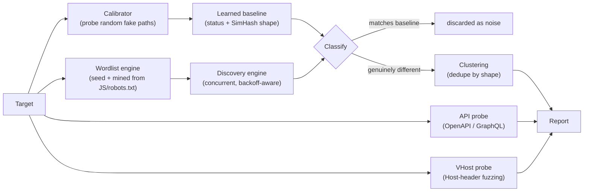

# HELLHOUND

```
██   ██  ███████  ██       ██       ██   ██  ███████  ██   ██  ██   ██  ██████
██   ██  ██       ██       ██       ██   ██  ██   ██  ██   ██  ███  ██  ██   ██
███████  █████    ██       ██       ███████  ██   ██  ██   ██  ██ █ ██  ██   ██
██   ██  ██       ██       ██       ██   ██  ██   ██  ██   ██  ██  ███  ██   ██
██   ██  ███████  ███████  ███████  ██   ██  ███████  ███████  ██   ██  ██████
```

**Calibrated recon that hunts instead of guessing.**

[](https://go.dev)
[](LICENSE)
[](#testing)
[](#testing)
[](#legal--ethics)

`ffuf` fuzzes. `katana` crawls. **Hellhound calibrates, hunts, and tells you what actually matters** — auto-learning what "not found" looks like on *this specific target* before it ever reports a single finding, so you read a handful of real hits instead of hand-tuning `-fc`/`-fs` against a wall of noise.

---

## Why Hellhound exists

Pure brute force (ffuf) and pure crawling (katana) both treat every endpoint the same way. Hellhound doesn't:

| | ffuf / katana | **Hellhound** |
|---|---|---|
| Soft-404 filtering | Manual `-fc`/`-fs` tuning, or none | **Auto-calibrated** per directory — probes random paths first, learns the real "not found" shape |
| Duplicate findings | One line per hit, even for 200 identical templated pages | **Clustered** by response shape — 200 blog posts become 1 line with a count |
| Wordlist | Static, supplied by you | **Mined from the target itself** — robots.txt, linked JS, tech fingerprinting |
| API surface | Guessed path by path | **Reads the target's own OpenAPI/Swagger spec or GraphQL schema directly** when exposed — one hit yields the entire route map |
| Virtual hosts | Not covered | **Calibrated Host-header fuzzing** finds internal vhosts DNS never advertised |
| Link crawling | katana crawls, ffuf can't | **Both**: calibrated fuzzing *and* same-origin multi-hop crawling (`-crawl`) — reaches pages that are only linked (a random slug, an internal report) which no wordlist can guess |
| Resilience | — | Survives WAF deny pages, redirect-everything proxies, dead targets, and malformed input *by design*, not by luck (see [Testing](#testing)) |

---

## How calibration actually works

Before Hellhound ever fuzzes a directory, it sends a handful of requests for paths that are almost certainly fake — then fingerprints the response (status code + a SimHash of the body, with the requested path itself redacted so an echoed-back "not found: /your-guess" page doesn't look unique every time). Every real candidate gets compared against that learned baseline. Only genuine deviations get reported.



---

## Install

```bash
go install github.com/securewithharshitrajput/hellhound/cmd/hellhound@v0.2.2
```

(Pin to a tagged version like `@v0.2.2` rather than `@latest` — Go's module proxy caches version lookups, and `@latest` against an untagged commit can serve a stale result until the proxy's cache naturally refreshes. A tagged release doesn't have that problem.)

This drops a `hellhound` binary into `$(go env GOBIN)` (usually `~/go/bin`) — the same place `ffuf`/`katana` live. Make sure that's on your `PATH` and you're done:

```bash
hellhound -u http://target.tld
```

**From source:**

```bash
git clone https://github.com/securewithharshitrajput/hellhound.git
cd hellhound
go install ./cmd/hellhound
```

---

## Quick start

```bash
# Basic scan — calibration, mining, clustering, API + nothing else needed
hellhound -u http://target.tld

# Bring your own wordlist, try backup extensions, raise concurrency
hellhound -u https://target.tld -w wordlist.txt -ext .bak,.old,.zip -c 60

# Hunt internal virtual hosts on a box you already have an IP for
hellhound -u http://10.0.0.5 -vhosts vhosts.txt

# Fuzz AND crawl — find guessable paths and link-only pages in one run
hellhound -u https://target.tld -crawl

# Authenticated scan behind an auth header, self-signed dev cert
hellhound -u https://staging.internal -H "Authorization: Bearer <token>" -k

# Save full structured output for other tooling
hellhound -u http://target.tld -json results.json
```

Sample run:

```
hellhound: mining robots.txt + homepage + linked JS for target-derived words...
hellhound: mined 3 additional word(s) from the target itself
hellhound: calibrating + scanning http://target.tld with 91 words x 2 extensions (depth=2, concurrency=40)
hellhound: done in 583ms, sent 10907 requests (0 backoff pauses)

hellhound: 21 findings in 9 cluster(s) for http://target.tld

  [200] http://target.tld/admin/users                    len=88     status 200 does not match any calibrated baseline shape
  [200] http://target.tld/api/internal/billing-export     len=104    status 200 does not match any calibrated baseline shape (+2 similar)
  [200] http://target.tld/swagger.json                    len=117    status 200 does not match any calibrated baseline shape

[openapi] spec found at /swagger.json — 5 routes declared:
    GET     /orders
    GET     /users
    POST    /users
    DELETE  /users/{id}
    GET     /users/{id}

[graphql] introspection enabled at /graphql — 3 root fields exposed:
    Mutation.deleteUser
    Query.listOrders
    Query.user
```

The banner at the top is randomized per run (Metasploit-style rotating tips) and auto-switches to a plain single line when stdout isn't a real terminal, so piping output never pollutes your logs.

---

## Flags

| Flag | Default | What it does |
|---|---|---|
| `-u` | *(required)* | Target base URL |
| `-w` | — | Wordlist file, one word per line — merged with the built-in seed and mined words |
| `-c` | `40` | Concurrent requests |
| `-depth` | `2` | Max recursion depth (`0` = scan only the given directory) |
| `-calibrate` | `6` | Calibration probes per directory |
| `-ext` | — | Comma-separated extensions to try, e.g. `.php,.bak,.old` |
| `-H` | — | Custom header, repeatable: `-H "Name: value"` |
| `-k` | `false` | Skip TLS verification (self-signed dev/staging certs **only** — never on production scope) |
| `-timeout` | `10s` | Per-request timeout |
| `-maxbody` | `512` (KB) | Max response body to read — raise it if a large OpenAPI/GraphQL spec looks truncated |
| `-vhosts` | — | Candidate-hostnames file for virtual-host discovery against `-u` |
| `-crawl` | `false` | Crawl real `<a href>`/`src`/`action` links (same-origin, multi-hop) to find linked pages no wordlist could guess |
| `-crawl-depth` | `3` | Max link-following depth when `-crawl` is set |
| `-crawl-max` | `500` | Max total pages to fetch when `-crawl` is set |
| `-no-mine` | `false` | Skip mining robots.txt/homepage/JS for target-derived words |
| `-no-banner` | `false` | Suppress the startup banner |
| `-json` | — | Write the full structured report to this path |

---

## Testing

This isn't "it compiled, ship it." The analyzer and engine were deliberately put through conditions that find real bugs, not just happy paths:

- **Fuzz testing** (`go test -fuzz`) on the core normalizer, calibrator, and OpenAPI/GraphQL parsers — millions of executions against adversarial and malformed input, including invalid UTF-8 (which did crash an earlier version — fixed and locked in with a regression test)
- **Race detector** (`-race`) on every test, including the concurrent worker pool and backoff/pause logic
- **Real blackhole/timeout targets** — verified the tool doesn't silently hang for minutes against an unresponsive host (found and fixed a sequential-probing bug that did exactly that)
- **WAF/deny-page and redirect-everything targets** — verified calibration suppresses the noise instead of flooding the report
- **50,000-word stress test** against a live server — found and fixed a ~0.1% false-positive edge case in redaction ordering
- **Goroutine leak checks** across repeated scans

51 tests passing, `go vet` and `gofmt` clean, zero known crashes.

```bash
go test ./...
go test ./... -race
go test ./internal/analyze/ -fuzz FuzzSimHash -fuzztime 30s
```

---

## Legal & ethics

Hellhound sends real HTTP requests to real servers. **Only point it at targets you are explicitly authorized to test** — your own infrastructure, a scope you have written permission for, or a CTF/lab environment built for this purpose. Unauthorized scanning of systems you don't own or have permission to test is illegal in most jurisdictions.

`-k` (skip TLS verification) exists for self-signed dev/staging certificates you control. Never use it to bypass certificate checks against a production target.

---

## Contributing

Issues and PRs welcome. If you're adding a feature, add the test that would have caught the bug it's meant to prevent — that's the standard the rest of this codebase holds itself to.

## License

[MIT](LICENSE)
