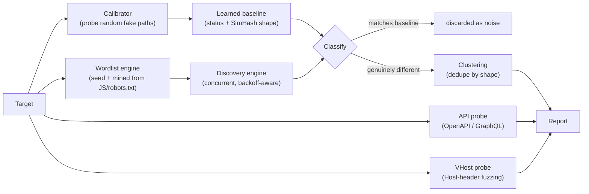

# HELLHOUND

```
██   ██  ███████  ██       ██       ██   ██  ███████  ██   ██  ██   ██  ██████
██   ██  ██       ██       ██       ██   ██  ██   ██  ██   ██  ███  ██  ██   ██
███████  █████    ██       ██       ███████  ██   ██  ██   ██  ██ █ ██  ██   ██
██   ██  ██       ██       ██       ██   ██  ██   ██  ██   ██  ██  ███  ██   ██
██   ██  ███████  ███████  ███████  ██   ██  ███████  ███████  ██   ██  ██████
```

**Calibrated recon that hunts, finds, and classifies what actually matters.**

[](https://go.dev)
[](LICENSE)
[](#testing)
[](#testing)
[](#legal--ethics)

`ffuf` fuzzes. `katana` crawls. **Hellhound calibrates, hunts, classifies, and tells you what's actually dangerous** — it auto-learns what "not found" looks like on *this specific target* so you read a handful of real hits instead of hand-tuning `-fc`/`-fs` against a wall of noise, and then it labels the dangerous ones: `[HIGH]` on an exposed `.env` or `.git/config`, `[MEDIUM]` on an open-redirect or dir-listing, `[LOW]` on `Server: nginx/1.21.3`.

---

## Why Hellhound exists

Pure brute force (ffuf) and pure crawling (katana) both treat every endpoint the same way. Hellhound doesn't:

| | ffuf / katana | **Hellhound** |
|---|---|---|
| Soft-404 filtering | Manual `-fc`/`-fs` tuning, or none | **Auto-calibrated** per directory — probes random paths first, learns the real "not found" shape |
| Duplicate findings | One line per hit, even for 200 identical templated pages | **Clustered** by response shape — 200 blog posts become 1 line with a count |
| Wordlist | Static, supplied by you | **Mined from the target itself** — robots.txt, linked JS, tech fingerprinting |
| API surface | Guessed path by path | **Reads the target's own OpenAPI/Swagger spec or GraphQL schema directly** when exposed — one hit yields the entire route map |
| Virtual hosts | Not covered | **Calibrated Host-header fuzzing** finds internal vhosts DNS never advertised |
| Link crawling | katana crawls, ffuf can't | **Both, and they feed each other**: calibrated fuzzing *and* same-origin multi-hop crawling (`-crawl`) — a page reached by following a link also seeds the fuzz wordlist, so each phase strengthens the other |
| Mid-scan blocking | floods findings when a WAF/bot-wall kicks in partway | **Detects the hit-rate spike, re-calibrates against the target's new behavior, and drops the block-page flood** — the Vercel failure, handled automatically |
| **Dangerous classification** | discovers endpoints and stops | **Tier-A security checks**: exposed `.env` / `.git/config` / backup SQL / private keys (HIGH), directory listings, open-redirects, dangerous HTTP methods (OPTIONS → PUT/DELETE/PATCH/TRACE) (MEDIUM), framework-version headers (LOW) — findings land in the same report with severity labels so you triage the dangerous stuff first |
| **Tech-aware wordlists** | one static list for every target | **Auto-detects the stack** (WordPress, Drupal, Joomla, Django, Rails, Laravel, Spring Boot, ASP.NET, PHP, Node) from one homepage fetch, then injects a curated path list for each (e.g. `/actuator/*` for Spring, `/rails/info/routes` for Rails, `wp-admin` / `xmlrpc.php` for WordPress) |
| Output | text / JSON | text, JSON, **CSV, and SARIF 2.1.0** (CI / GitHub code scanning) — SARIF rules split per finding type so a GitHub dashboard shows the real problems in red, discovery noise in gray |
| Engagement fit | ffuf has `-x`/`-rate`; katana limited | **Proxy (`-x`) for Burp/ZAP + true requests/sec rate limit (`-rate`)** to stay under WAF/bot thresholds |
| Resilience | — | Survives WAF deny pages, redirect-everything proxies, dead targets, and malformed input *by design*, not by luck (see [Testing](#testing)) |

---

## How calibration actually works

Before Hellhound ever fuzzes a directory, it sends a handful of requests for paths that are almost certainly fake — then fingerprints the response (status code + a SimHash of the body, with the requested path itself redacted so an echoed-back "not found: /your-guess" page doesn't look unique every time). Every real candidate gets compared against that learned baseline. Only genuine deviations get reported.



---

## Install

```bash
go install github.com/securewithharshitrajput/hellhound/cmd/hellhound@v0.8.0
```

(Pin to a tagged version like `@v0.8.0` rather than `@latest` — Go's module proxy caches version lookups, and `@latest` against an untagged commit can serve a stale result until the proxy's cache naturally refreshes. A tagged release doesn't have that problem.)

This drops a `hellhound` binary into `$(go env GOBIN)` (usually `~/go/bin`) — the same place `ffuf`/`katana` live. Make sure that's on your `PATH` and you're done:

```bash
hellhound -u http://target.tld
```

**Prebuilt binaries (no Go needed):** every tagged version has archives for Linux, macOS and Windows (amd64 and arm64) with a `SHA256SUMS` file on the [Releases page](https://github.com/securewithharshitrajput/hellhound/releases). Download, verify the checksum, unpack, and put `hellhound` on your `PATH`.

**From source:**

```bash
git clone https://github.com/securewithharshitrajput/hellhound.git
cd hellhound
go install ./cmd/hellhound
```

---

## Quick start

```bash
# Basic scan — calibration, mining, clustering, API + nothing else needed
hellhound -u http://target.tld

# Bring your own wordlist, try backup extensions, raise concurrency
hellhound -u https://target.tld -w wordlist.txt -ext .bak,.old,.zip -c 60

# Hunt internal virtual hosts on a box you already have an IP for
hellhound -u http://10.0.0.5 -vhosts vhosts.txt

# Fuzz AND crawl — find guessable paths and link-only pages in one run
hellhound -u https://target.tld -crawl

# Route through Burp for inspection, throttled to stay under WAF thresholds
hellhound -u https://target.tld -x http://127.0.0.1:8080 -k -rate 20

# Authenticated scan behind an auth header, self-signed dev cert
hellhound -u https://staging.internal -H "Authorization: Bearer <token>" -k

# Save structured output — JSON, CSV, and SARIF (for CI code scanning) at once
hellhound -u http://target.tld -json out.json -csv out.csv -sarif out.sarif
```

Sample run:

```
hellhound: mining robots.txt + homepage + linked JS for target-derived words...
hellhound: mined 3 additional word(s) from the target itself
hellhound: detected stack(s): wordpress, php
hellhound: injected 24 tech-specific word(s)
hellhound: calibrating + scanning http://target.tld with 115 words x 2 extensions (depth=2, concurrency=40)
hellhound: done in 591ms, sent 13208 requests (0 backoff pauses)

hellhound: running Tier-A security checks (sensitive files, dir listings, dangerous methods, open-redirect, info-disclosure)...
hellhound: security checks done in 94ms — 6 finding(s)

hellhound: 21 findings in 9 cluster(s) for http://target.tld

  [200] http://target.tld/admin/users                    len=88     status 200 does not match any calibrated baseline shape
  [200] http://target.tld/api/internal/billing-export    len=104    status 200 does not match any calibrated baseline shape (+2 similar)
  [200] http://target.tld/swagger.json                   len=117    status 200 does not match any calibrated baseline shape

[security] 6 finding(s):
  [HIGH  ] sensitive-file  http://target.tld/.env
        environment file commonly contains database and API credentials
        evidence: variables: APP_ENV, DB_PASSWORD, SECRET_KEY (values redacted)
  [HIGH  ] sensitive-file  http://target.tld/.git/config
        .git directory exposed — attacker can reconstruct full source tree
        evidence: [core]
  [MEDIUM] dangerous-methods  http://target.tld/api/users
        server advertises PUT, DELETE, PATCH via OPTIONS Allow header
        evidence: GET, POST, PUT, DELETE, PATCH, OPTIONS
  [MEDIUM] dir-listing  http://target.tld/uploads/
        directory listing enabled — every filename in this directory is enumerable
  [MEDIUM] open-redirect  http://target.tld/go?url=https://legit.example.com/
        parameter url is reflected into the Location header without validation
  [LOW   ] info-disclosure  http://target.tld
        Server header exposes server software and version: nginx/1.21.3

[openapi] spec found at /swagger.json — 5 routes declared:
    GET     /orders
    GET     /users
    POST    /users
    DELETE  /users/{id}
    GET     /users/{id}

[graphql] introspection enabled at /graphql — 3 root fields exposed:
    Mutation.deleteUser
    Query.listOrders
    Query.user
```

The banner at the top is randomized per run (Metasploit-style rotating tips) and auto-switches to a plain single line when stdout isn't a real terminal, so piping output never pollutes your logs.

---

## Flags

| Flag | Default | What it does |
|---|---|---|
| `-u` | *(required)* | Target base URL |
| `-w` | — | Wordlist file, one word per line — merged with the built-in seed and mined words |
| `-c` | `40` | Concurrent requests (1–1000) |
| `-depth` | `2` | Max recursion depth (`0` = scan only the given directory) |
| `-calibrate` | `6` | Calibration probes per directory (minimum 2; more are sent automatically when the not-found pages disagree) |
| `-ext` | — | Comma-separated extensions to try, e.g. `.php,.bak,.old` |
| `-H` | — | Custom header, repeatable: `-H "Name: value"` |
| `-k` | `false` | Skip TLS verification (self-signed dev/staging certs **only** — never on production scope) |
| `-x` | — | Route all requests through an HTTP proxy, e.g. `http://127.0.0.1:8080` for Burp/ZAP (HTTPS through Burp usually also needs `-k`) |
| `-rate` | `0` | Max requests/sec across all workers (0 = unlimited) — stay under a target's rate-based WAF/bot thresholds |
| `-timeout` | `10s` | Per-request timeout |
| `-maxbody` | `512` (KB) | Max response body to read — raise it if a large OpenAPI/GraphQL spec looks truncated |
| `-vhosts` | — | Candidate-hostnames file for virtual-host discovery against `-u` |
| `-crawl` | `false` | Crawl real `<a href>`/`src`/`action` links (same-origin, multi-hop) to find linked pages no wordlist could guess |
| `-crawl-depth` | `3` | Max link-following depth when `-crawl` is set |
| `-crawl-max` | `500` | Max total pages to fetch when `-crawl` is set |
| `-no-mine` | `false` | Skip mining robots.txt/homepage/JS for target-derived words |
| `-no-tech` | `false` | Skip tech-stack fingerprinting + tech-specific wordlist injection |
| `-no-security` | `false` | Skip Tier-A security checks (sensitive files, dir listing, dangerous HTTP methods, open-redirect, info-disclosure headers) |
| `-no-banner` | `false` | Suppress the startup banner |
| `-json` | — | Write the full clustered JSON report (incl. security findings) to this path |
| `-csv` | — | Write findings as CSV (one row per finding, security findings tagged `security`) to this path |
| `-sarif` | — | Write findings as SARIF 2.1.0 to this path (for CI / GitHub code scanning) |
| `-mc` | — | Always report these status codes, even when calibration judged them to be the not-found page: `-mc 401,403`, `-mc 500-599` |
| `-fc` | — | Never report these status codes: `-fc 404,418`, `-fc 300-399`. Wins over `-mc` |
| `-fs` | — | Never report responses whose body is exactly this many bytes: `-fs 0,1234` |
| `-scope` | — | Scope file: the hosts and paths the scan may touch, with `!` exclusions. Enforced on every request (see [Scope](#scope)) |
| `-resume` | — | State file, saved after every completed directory. If it exists, the scan continues from it (see [Resume](#resume)) |
| `-render` | `false` | With `-crawl`: render each page in a local headless Chrome/Chromium and follow links that only exist after its JavaScript ran (see [Rendering](#rendering)) |
| `-render-browser` | auto | Path or name of the browser binary for `-render` |
| `-config` | — | Config file, one `name = value` per line for any flag; the command line overrides it |
| `-profile` | — | Preset defaults: `quick`, `deep` or `gentle`; a config file and the command line override it |
| `-no-progress` | `false` | Do not draw the live progress line (it is only drawn on a terminal) |
| `-version` | | Print the version and exit |

### Tier-A security findings

Hellhound classifies each endpoint it discovers against a dedicated set of security probes and content checks. Everything that triggers lands in the `[security]` block of stdout and (with their severity preserved) in the JSON/CSV/SARIF outputs. The checks are:

| Check | What it looks for | Typical severity |
|---|---|---|
| **sensitive-file** | `.env`, `.git/config`, `.htpasswd`, `backup.sql`, `/id_rsa`, `wp-config.php.bak`, Terraform state, `/credentials.json`, 40+ well-known dangerous paths — each confirmed by content markers (no soft-404 false positives) | HIGH |
| **dir-listing** | Response body matches Apache/nginx/Python-SimpleHTTPServer's directory-index fingerprint — every filename enumerable, non-linked backups exposed | MEDIUM |
| **dangerous-methods** | `OPTIONS` on each discovered endpoint; flags any `Allow:` header advertising `PUT` / `DELETE` / `PATCH` (MEDIUM) or `TRACE` alone (LOW, XST primitive) | MEDIUM / LOW |
| **open-redirect** | Any discovered URL whose query carries a redirect-shaped parameter (`url`, `next`, `redirect`, `redirect_uri`, `goto`, `return`, `callback`, …) is re-sent with a canary external URL; a 3xx `Location:` reflecting it is flagged | MEDIUM |
| **info-disclosure** | `Server`, `X-Powered-By`, `X-AspNet-Version`, `X-Rails-Version`, `X-Generator`, `X-Application-Context`, etc. — deduplicated per host so a 10,000-request scan doesn't flood with the same banner | LOW / INFO |

These checks are built to stay quiet on targets that answer `200` for everything (single-page apps, WAF block pages, catch-all routers):

- **sensitive-file** needs a file-specific structural match (an env assignment line, a key header, a file magic, a JSON key), rejects HTML documents, and rejects any response shaped like what the target returns for random nonexistent files.
- **dangerous-methods** probes a random nonexistent path per origin; a blanket `Allow` header is reported once for the origin instead of once per URL.
- **open-redirect** requires the `Location` host to be the canary itself — a same-site bounce that carries the parameter along (`/login?next=...`) is not flagged.
- **info-disclosure** reports per-response values (`X-Runtime`, `X-Varnish`, `Via`, ...) once per host.
- Evidence never repeats secret values: env files list variable names only, and excerpts stop at the matched marker.

Hellhound also refuses to "scan" a target it cannot reach: an unreachable host or a URL without `http://`/`https://` ends the run with an error and a non-zero exit code instead of a clean-looking `0 findings`.

---

## Testing

This isn't "it compiled, ship it." The analyzer and engine were deliberately put through conditions that find real bugs, not just happy paths:

- **Fuzz testing** (`go test -fuzz`) on the core normalizer, calibrator, and OpenAPI/GraphQL parsers — millions of executions against adversarial and malformed input, including invalid UTF-8 (which did crash an earlier version — fixed and locked in with a regression test)
- **Race detector** (`-race`) on every test, including the concurrent worker pool and backoff/pause logic
- **Real blackhole/timeout targets** — verified the tool doesn't silently hang for minutes against an unresponsive host (found and fixed a sequential-probing bug that did exactly that)
- **WAF/deny-page and redirect-everything targets** — verified calibration suppresses the noise instead of flooding the report
- **50,000-word stress test** against a live server — found and fixed a ~0.1% false-positive edge case in redaction ordering
- **Goroutine leak checks** across repeated scans

180 tests and fuzz targets passing (every Tier-A detector carries fingerprint, false-positive-rejection and catch-all-target regression tests, plus fuzzing of everything that parses target-controlled bodies and headers), `go vet` and `gofmt` clean, zero known crashes.

```bash
go test ./...
go test ./... -race
go test ./internal/analyze/ -fuzz FuzzSimHash -fuzztime 30s
```

---

## Scope

`-scope file` confines the scan. The file has one rule per line; blank lines and `#` comments are ignored, and a leading `!` makes a rule an exclusion:

```
# what this engagement covers
app.example.com
*.dev.example.com
api.example.com:8443
https://shop.example.com/store/

# never touch these
!/logout
!/admin/billing
!*/delete*
```

| Rule form | Matches |
|---|---|
| `example.com` | that host, any port, any path |
| `*.example.com` | any subdomain |
| `example.com:8443` | that host on one port |
| `https://example.com/app/` | scheme, host and a path prefix |
| `/admin` | a path prefix (segment-bounded: not `/administrator`) on any allowed host |
| `*/delete*`, `/api/*/export` | a path glob; `*` matches any run of characters |

A URL is in scope when no exclusion matches and, if the file has any non-exclusion rule, one of them does. Exclusions always win. Paths are matched after percent-decoding. The check sits inside the HTTP engine, so fuzzing, crawling, security probes and API probing are all covered; requests that fall outside are not sent and are counted at the end. Hellhound refuses to start if the target itself is out of scope.

Independently of any scope file, hellhound only sends requests to the target's own host and port: a link, redirect or sitemap entry cannot pull the scan elsewhere.

## Resume

```bash
hellhound -u https://target.tld -w big.txt -resume scan.state
```

The state file is written (atomically) each time a directory finishes. If the scan is interrupted, run the same command again: completed directories and their findings are loaded, and the scan continues with the queued ones. Only the directory that was in progress is scanned again. The saved scan's wordlist, extensions, depth and calibration size are reused so the continuation tests the same candidates. The file is removed when the scan completes, and a state file from a different target is rejected.

## Config files and profiles

```
# hh.conf
u = https://staging.example.com
w = /opt/lists/common.txt
depth = 3
crawl
scope = scope.txt
H = Authorization: Bearer <token>
H = X-Engagement: ACME-2026
```

```bash
hellhound -config hh.conf            # everything from the file
hellhound -config hh.conf -depth 0   # the command line overrides the file
hellhound -profile gentle -u https://prod.example.com
```

Precedence: profile < config file < command line.

| Profile | Sets |
|---|---|
| `quick` | root directory only, 60 workers |
| `deep` | depth 4, crawling to depth 5 (2000 pages), 8 calibration probes |
| `gentle` | 4 workers, 8 requests/sec, depth 1, 20s timeout — for fragile or production targets |

## Rendering

A single-page app's HTML is an empty shell; its links exist only after its scripts run. `-crawl -render` loads each crawled page in a Chrome or Chromium **already installed on your machine** (headless) and follows the links found in the resulting DOM. Nothing is downloaded or bundled and hellhound has no Go dependency for this.

- The crawler still fetches every page itself, so scope rules, rate limits, headers and status handling apply as usual; the browser only contributes links.
- The browser is confined to the target's hostname: other hostnames are made unresolvable, so third-party scripts, trackers and fonts are not fetched.
- It runs with its own sandbox enabled, in a throw-away profile that is deleted afterwards; hellhound refuses to render as root rather than disable the sandbox.
- Limits: the browser does not send your `-H` headers (pages are rendered as an anonymous visitor), it does load same-host sub-resources of the pages it renders, and each page costs a browser start (about a second), up to three in parallel.

## Behaviour on difficult targets

Hellhound is tested against a set of deliberately hostile targets, each with a known ground truth, and must report exactly the real endpoints on every one:

| Target behaviour | What hellhound does |
|---|---|
| "Not found" pages whose content changes on every request (random recommendations, rotating tokens on a short page) | Detects that the calibration probes disagree, doubles the sample, and switches that directory to vocabulary-based filtering — with one warning, because a real page reusing the same wording can be missed |
| Hit rate still implausible after calibration | Learns the baseline again from a larger sample and re-requests every remaining hit, keeping only those that still stand out |
| Rate limiting (`429`) | Backs off, retries up to three times, never reports a `429` as a finding, and says how many paths were left unchecked |
| Dropped connections | Retries a reset/closed connection once; timeouts are not retried |
| Target under a path prefix (`-u http://host/app`) | Recurses relative to the prefix |
| Case-insensitive servers (IIS and similar) | Detects it once and merges `/Admin`, `/ADMIN`, `/admin` into one finding and one directory |
| Hostile wordlist entries (spaces, `#`, stray `%`, control and non-ASCII bytes) | Percent-encodes what a URL cannot carry; valid `%XX` escapes and query strings are kept |
| Crawl traps (endless calendars, session ids in links, 70 KB links, logout links) | Dedupes on path + parameter names, skips over-long links and logout/sign-out links, never reports dead links |
| Escape sequences in titles, headers, redirect targets or API schema names | Rendered as visible text (`\x1b[31m`) in the terminal and in JSON/CSV/SARIF; CSV cells that would be read as spreadsheet formulas are neutralised |
| Unreachable target, bad URL, unreadable `-w`/`-vhosts` file, unwritable report path, out-of-range flag | Refused before anything is sent, with a message naming the problem and a non-zero exit code |

Exit codes: `0` scan completed, `1` target unreachable or a report could not be written, `2` invalid arguments, `130` interrupted (partial results are still printed and written).

## Legal & ethics

Hellhound sends real HTTP requests to real servers. **Only point it at targets you are explicitly authorized to test** — your own infrastructure, a scope you have written permission for, or a CTF/lab environment built for this purpose. Unauthorized scanning of systems you don't own or have permission to test is illegal in most jurisdictions.

`-k` (skip TLS verification) exists for self-signed dev/staging certificates you control. Never use it to bypass certificate checks against a production target.

---

## Contributing

Issues and PRs welcome. If you're adding a feature, add the test that would have caught the bug it's meant to prevent — that's the standard the rest of this codebase holds itself to.

## License

[MIT](LICENSE)
